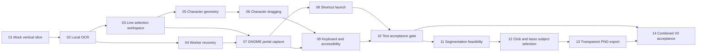

# Development V0 Roadmap

V0 proves two local interaction capabilities in order:

1. **Text:** capture visible content and drag across exact character ranges.
2. **Subject Lift:** click or draw around a subject and export a transparent
   PNG.

Text is the first exit gate. Subject Lift does not delay judgment of the OCR
architecture, but both milestones must pass before combined V0 acceptance.

## Milestone A: foundation — complete

- Mock Flutter-to-Python vertical slice.
- Fully local RapidOCR image recognition.
- Spatial line selection, deterministic copy, selectable text panel, zoom, and
  responsive Ubuntu-style UI.
- Request correlation, cancellation, timeout, restart, retry, process cleanup,
  and safe user-facing failures.

## Milestone B: Text

### 05 — Character geometry — complete

Prove which local OCR path can return reliable character or text-range geometry
for punctuation, URLs, code, whitespace, small fonts, rotation, and
perspective. No UI approximation is allowed to masquerade as measured
geometry.

### 06 — Character dragging — complete

Implement direct pointer dragging across partial words and multiple lines,
partial-range highlights, exact copied substrings, zoom-safe hit testing, and
keyboard-equivalent range extension.

### 07 — GNOME portal capture

Capture an area, window, or screen through GNOME's XDG Screenshot portal and
feed the result through the same local OCR workflow. A paused video is treated
as visible screen content.

### 08 — Shortcut launch

Provide a stable command for a user-configured GNOME shortcut, support cold and
existing-process activation, and keep one bounded capture session.

### 09 — Keyboard and accessibility

Complete focus order, selection shortcuts, screen-reader semantics, status
announcements, high contrast, large text, and predictable focus restoration.

### 10 — Text acceptance gate

Publish reproducible OCR quality, character-geometry, latency, memory, privacy,
Wayland, multi-monitor, fractional-scaling, keyboard, and Orca evidence. Decide
whether the current OCR adapter and Flutter/Python architecture remain viable.

## Milestone C: Subject Lift

### 11 — Segmentation feasibility

Benchmark local interactive segmentation candidates on Ubuntu CPU for model
size, startup, image embedding, click response, lasso response, mask quality,
licensing, ONNX support, and offline distribution. Choose only a V0 adapter,
not the final production model.

### 12 — Click and lasso selection

Compute one embedding per capture, select a subject from a point or drawn
region, render its mask, support add/remove/refinement prompts, and keep OCR and
subject selection as explicit modes in the same result surface.

### 13 — Transparent PNG export

Apply the selected mask to the source pixels, crop to useful bounds, generate
an RGBA PNG, copy an image payload to the Linux clipboard, save through the
system file chooser, and clean temporary output.

### 14 — Combined V0 acceptance

Measure the end-to-end shortcut-to-result workflows for both Text and Subject
Lift. Record limitations and decide what enters the installable alpha.

## V0 boundaries

- Ubuntu 24.04 GNOME Wayland is the acceptance target.
- Processing is local and offline; LLMs, cloud OCR, and remote segmentation are
  excluded.
- The result is a frozen capture in a normal application surface. V0 does not
  inject selectable content into another application's widget tree.
- Continuous video analysis, persistent history, semantic object naming,
  translation, production packaging, and upstream integration remain outside
  V0.
