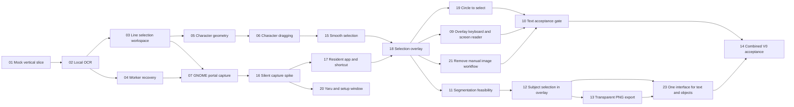

# Kiriglyph Development V0 Roadmap

V0 proves two local interaction capabilities, both inside one selection
overlay opened by a GNOME shortcut:

1. **Text:** freeze the display under the pointer and select exact text by
   dragging, double-click, triple-click, or a rough circle that snaps to
   paragraphs.
2. **Subject Lift:** click or draw around a subject and export it as a
   transparent PNG.

There is no manual open-an-image workflow. The normal window is a setup window
only.

Text is the first exit gate. Subject Lift does not delay judgment of the OCR
architecture, but both must pass before combined V0 acceptance.

## Milestone A: foundation — complete

- Mock Flutter-to-Python vertical slice.
- Fully local RapidOCR image recognition.
- Spatial line selection, deterministic copy, zoom, and responsive
  Ubuntu-style UI. Its selection canvas is now shared with the overlay.
- Request correlation, cancellation, timeout, restart, retry, process cleanup,
  and safe user-facing failures.

## Milestone B: Text in the overlay

### Complete

- **05** Character geometry: measured per-character geometry from the OCR path.
- **06** Character dragging: partial words, multiline ranges, exact substrings.
- **07** Portal capture: superseded; its helper is reused silently
  ([ADR 0001](../../docs/adr/0001-selection-overlay-silent-capture.md)).
- **15** Smooth selection: one continuous highlight band per line.
- **16** Silent capture spike: one-time grant, 520 ms capture, display placement.
- **17** Resident app and shortcut: autostart hidden, single instance, warm
  worker, `--select` activation. Replaces 08.
- **18** Selection overlay: frozen borderless view of the active display, glow
  and scanning animation, accepted at 100% and 125% on one and two displays.
- **19** Circle to select: freehand circle, paragraph snapping, triple-click
  paragraph, paragraph-aware copy.
- **20** Yaru and setup window: Ubuntu theme, onboarding, permission flow.
- **21** Remove the manual image workflow: overlay-only selection; setup window
  only in the normal window.
- **22** Rename to Kiriglyph: product name, app ID, scripts, and docs.
- **09** Overlay keyboard and screen reader: focus on open, Tab order,
  Ctrl+Shift+Up/Down paragraph selection, reading-order semantics, brief
  announcements, large-text and high-contrast legibility. Implemented with
  widget tests; Orca and keyboard-only checks are recorded in 10.

### Ready for human acceptance

- **10** Text acceptance gate: automated corpus, privacy/resource harnesses,
  timing instrumentation, and draft report are ready; the remaining work is the
  real GNOME Wayland manual checklist and release-build measurements.

## Milestone C: Subject Lift in the overlay

- **11** Segmentation feasibility: resolved with EfficientSAM-Ti as the V0 adapter candidate.
- **12** Subject selection: backend process, EfficientSAM adapter, mask transport,
  Dart port, explicit model fetch, and overlay UI are implemented. Real-model
  and multi-display manual evidence moves to 14.
- **13** Transparent PNG export: Dart cutout compositing, native image
  clipboard, GTK save chooser, atomic save, focus-loss guard, toolbar buttons,
  shortcuts, and automated export tests are implemented. Real Wayland paste
  targets, chooser behavior, and multi-display export evidence move to 14.
- **23** One interface for text and objects: implemented; the app
  decides from where the user clicks or draws, with a hint chip to flip the
  reading. Ready once the desktop-testing fixes to 12 and 13 land.
- **14** Combined V0 acceptance: OCR and Subject fixture evidence, bounded
  worker checks, privacy/resource harnesses, timing instrumentation, and draft
  report are ready; the remaining work is the real GNOME Wayland manual
  checklist and final alpha decision.

## Milestone D: Beta polish

- **25** Selection experience, native Ubuntu look, and accessibility:
  rectangle default, screenshot save and copy, smart detection and web search,
  Yaru look, draggable toolbar, persistent glow, accessibility must-haves.
  Implemented; manual acceptance (real desktop, Orca) is open.
- **26** Resident app, top-bar icon, instant open, and beta `.deb`. Runs in
  parallel with 25; the `.deb` waits for 25's worker dependencies. Implemented;
  its instant-open design was superseded by 27. The `.deb` passes lintian and a
  clean-room install, start, upgrade, remove and purge on Ubuntu 26.04
  (`scripts/acceptance/deb-clean-room/`). Manual acceptance of the Orca tray
  menu and a full-desktop VM install is open.
- **27** No black frame on GNOME Wayland: the overlay finds its display with a
  probe window, then maps fullscreen once with the frozen frame already
  rendered ([ADR 0002](../../docs/adr/0002-overlay-maps-once-on-a-located-display.md)).
  Implemented and confirmed on the owner's desktop; two-display and 125% runs
  are open.
- **28** Preferences window, automatic shortcut, and save location: one native
  header bar with an About and Quit menu, grouped settings rows, the GNOME
  shortcut added on first run and changeable in the window, and a save-folder
  setting ([ADR 0003](../../docs/adr/0003-app-sets-its-own-shortcut-on-first-run.md)).
  Implemented; manual check on the owner's desktop is open.

## V0 boundaries

- Ubuntu 26.04 GNOME 50 Wayland is the acceptance target.
- Processing is local and offline; LLMs, cloud OCR, and remote inference are
  excluded.
- The result is a frozen capture shown in a borderless overlay on the active
  display. V0 does not inject selectable content into another application's
  widget tree.
- Continuous video analysis, persistent history, semantic object naming,
  translation, production packaging, and upstream integration remain outside
  V0.

## Release 0.1.0 (first public beta)

Licence chosen ([ADR 0004](../../docs/adr/0004-apache-2-licence.md)), package
polished and checked on a clean Ubuntu, repository prepared for the public.
Steps to publish are in [docs/packaging.md](../../docs/packaging.md#releasing).
Known limits stay listed in the README's Project status.
