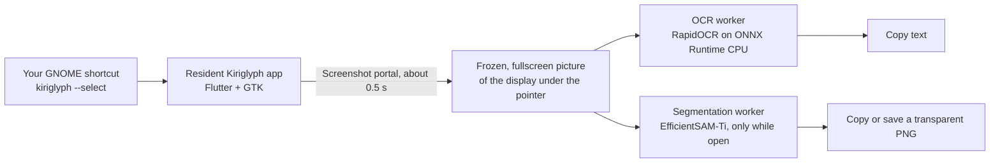

<div align="center">

# Kiriglyph

**Select and copy text from anything on your screen, or cut out any object as a transparent PNG, with one keyboard shortcut. Everything runs on your machine.**

<p align="center">
  
  
  
  
  
  <a href="LICENSE"></a>
</p>

[Features](#features) · [Installation](#installation) · [Usage](#usage) · [How it works](#how-it-works) · [Privacy](#privacy) · [Troubleshooting](#troubleshooting) · [Development](#development)

</div>

<!-- Demo goes here: a 10-20 second recording of pressing the shortcut, selecting text, then lifting an object.
     Save it under docs/images/ and embed it with a standard Markdown image tag. Crop out anything private first. -->

Kiriglyph is a desktop tool for Ubuntu (GNOME on Wayland). Press a shortcut and the display under your pointer freezes. Drag across any text you can see and copy it, or click anything else and lift it out as a transparent PNG. It works offline: no cloud OCR, no LLM, no upload.

The name joins *kiri* (Japanese for "cut") and *glyph* (a character): it cuts characters and subjects out of whatever is on your screen.

## Features

- **Copy text from anything on screen**: videos, images, remote desktops and apps that block copying.
- **Cut out any object** as a transparent PNG with one click.
- **Screenshot just an area**, or the whole display, to the folder you choose.
- **Smart actions** for links, emails, phone numbers and QR codes, always confirmed before anything opens.
- **Always ready**: starts at login with a top-bar icon, and sets up its own shortcut on first run.
- **Private**: recognition and cut-outs run on your machine, with no cloud and no upload.
- **Native and accessible**: Ubuntu look with light and dark mode, and fully usable from the keyboard.

How each one works, and every key and mouse action, is in [Usage](#usage).

## Installation

**Requirements:** Ubuntu 26.04 LTS with GNOME 50 on a **Wayland** session, which is what Kiriglyph is built and tested on. X11 is not supported, and other GNOME distributions are untested. Object cut-outs use about 1.3 GiB of memory while they are loaded, so a few GiB of RAM is comfortable.

### Install the `.deb` (recommended)

**[⬇ Download kiriglyph_amd64.deb](https://github.com/ne0-d/kiriglyph/releases/latest/download/kiriglyph_amd64.deb)** (about 170 MB, everything included; all versions are on the [Releases](https://github.com/ne0-d/kiriglyph/releases) page)

Then install it either way:

- **With the mouse:** open the downloaded file and choose **Install**.
- **In a terminal:** `sudo apt install ./kiriglyph_amd64.deb` (use `apt`, not `dpkg -i`, so dependencies are installed too).

Check it worked with `kiriglyph --version`. The package bundles its own Python runtime and the models, so nothing is downloaded when you use it.

To verify the download first, get `SHA256SUMS` from the same release page and run `sha256sum -c SHA256SUMS` in the folder with the `.deb`.

### First-time setup

1. **Open Kiriglyph** from the app grid. Its window opens.
2. **Click Allow** next to *Screen access*. GNOME asks once, and only while this window is focused. Without it, shortcut captures are refused.
3. **Press Ctrl+Super+T** on any screen. Kiriglyph already added this shortcut for you; the window shows it, and **Change…** picks another.

If GNOME's keyboard settings cannot be reached, the window shows the command to add yourself in **Settings → Keyboard → View and Customize Shortcuts → Custom Shortcuts**.

### Update

Download the newer `.deb` and install it the same way. Your settings, shortcut, and screen-access grant are kept. Kiriglyph keeps running in the background, so the old version stays active until you restart it: run `kiriglyph --quit`, then open Kiriglyph again (or log out and back in).

### Uninstall

```bash
sudo apt remove kiriglyph
```

`apt remove` leaves your data in place, and the login autostart entry too; use `sudo apt purge kiriglyph` instead to remove that entry as well. To clear your own data too: delete `~/.config/kiriglyph` and `~/.config/autostart/dev.kiriglyph.Kiriglyph.desktop`, remove the Kiriglyph shortcut in **Settings → Keyboard**, and revoke screen access in **Settings → Apps**.

### Install from source

This installs for your user only and needs a development setup.

```bash
sudo apt-get update
sudo apt-get install -y clang pkg-config libgtk-3-dev libstdc++-12-dev

git clone https://github.com/ne0-d/kiriglyph.git
cd kiriglyph

./scripts/bootstrap.sh          # pins Flutter and the Python tools inside the repo
./scripts/install-desktop.sh    # builds, installs, and starts Kiriglyph hidden
```

`install-desktop.sh` puts the launcher at `~/.local/bin/kiriglyph`, adds a desktop entry and a login autostart entry, and starts the app in the background. It changes no GNOME settings; the app adds its shortcut itself on first run. Then follow [First-time setup](#first-time-setup).

Object cut-outs need the segmentation model files (about 41 MB). This one command downloads them from Hugging Face and checks their checksums; it is the only download Kiriglyph ever makes:

```bash
cd worker && ../.tools/uv-bin/uv run --locked kiriglyph-fetch-models
```

To update, run `git pull` and `./scripts/install-desktop.sh` again. To remove it, run `./scripts/uninstall-desktop.sh`.

### Build the `.deb` yourself

```bash
./scripts/build-deb.sh
sudo apt install ./dist/kiriglyph_amd64.deb
```

The script builds the release bundle, creates a private Python runtime, fetches and verifies the models, and writes `dist/kiriglyph_<version>_amd64.deb`, a copy named `kiriglyph_amd64.deb` (the name releases use), and `SHA256SUMS`. Layout, checks and the release steps: [docs/packaging.md](docs/packaging.md).

## Usage

Press your shortcut. The display under your pointer freezes and the toolbar appears. The Rectangle tool is the default, and **Esc** closes everything.

### Three quick recipes

- **Copy text from a video or image:** press the shortcut, drag across the words, press <kbd>Ctrl</kbd>+<kbd>C</kbd>. Paste anywhere.
- **Cut out an object:** press the shortcut, click the object (or draw around it), then <kbd>Ctrl</kbd>+<kbd>C</kbd> to copy the transparent PNG, or <kbd>Ctrl</kbd>+<kbd>S</kbd> to save it.
- **Screenshot one area:** press the shortcut, drag a rectangle, choose **Copy screenshot** or **Save screenshot**.

### The Kiriglyph window

Open **Kiriglyph** from the app grid to change settings. Closing the window leaves the app running in the background.

| Setting | What it does |
| --- | --- |
| Screen access | Lets Kiriglyph capture the screen when you press the shortcut. GNOME asks once. |
| Shortcut | The key combination that opens the overlay. **Change…** records a new one and warns if something else already uses it. |
| Save location | The folder for saved PNGs. The default is your Pictures folder. |
| Launch at login | Starts Kiriglyph hidden so the shortcut is ready. |
| Pause shortcut | Ignores the shortcut until you turn this off. |
| Try it now | Starts a selection from the window. |

To quit, use **Quit Kiriglyph** in the window's main menu (the ☰ button) or in the top-bar icon's menu.

### With the mouse

| Do this | You get |
| --- | --- |
| Drag across text | Character-exact text selection |
| Double-click / triple-click text | A word / a paragraph |
| Drag anywhere else | A rectangle with resize handles, then buttons: Copy text, Lift object, Copy screenshot, Save screenshot |
| Click something that is not text | That object, lifted out |
| <kbd>Shift</kbd>+click / <kbd>Alt</kbd>+click or right-click | Add to the object / leave a part out |
| <kbd>Ctrl</kbd>+click or drag | Force object selection over text |
| Free draw tool (<kbd>T</kbd>), circle something | Kiriglyph decides text or object; a button flips the reading |

### With the keyboard

| Keys | Action |
| --- | --- |
| <kbd>Ctrl</kbd>+<kbd>C</kbd> | Copy the selected text, or the object as a transparent PNG |
| <kbd>Ctrl</kbd>+<kbd>Shift</kbd>+<kbd>C</kbd> | Copy the selection as an image |
| <kbd>Ctrl</kbd>+<kbd>S</kbd> | Save the main result to your save folder as `kiriglyph-YYYYMMDD-HHMMSS.png` |
| <kbd>Ctrl</kbd>+<kbd>Shift</kbd>+<kbd>S</kbd> / <kbd>Ctrl</kbd>+<kbd>Shift</kbd>+<kbd>F</kbd> | Save an object with Save as... / save the whole display |
| Arrow keys, <kbd>Ctrl</kbd>+<kbd>Shift</kbd>+<kbd>↑</kbd>/<kbd>↓</kbd> | Move over text; select by paragraph |
| <kbd>R</kbd>, arrow keys, <kbd>Alt</kbd>+arrows | Start, resize, and move a rectangle |
| <kbd>O</kbd>, <kbd>Enter</kbd> | Pick an object area and select it |
| <kbd>Ctrl</kbd>+<kbd>Z</kbd>, <kbd>Backspace</kbd> | Undo the last object point; clear the object |
| <kbd>?</kbd> or <kbd>F1</kbd> | Show every shortcut |
| <kbd>Esc</kbd> | Step back, then close |

### Command line

```text
kiriglyph --select       open the selection overlay (what the shortcut runs)
kiriglyph --background   start hidden, as the login autostart does
kiriglyph --quit         ask the running app to quit
kiriglyph --version      print the version (the .deb launcher)
```

## How it works



- **Wayland does not let an app read the screen or draw over other windows.** So Kiriglyph asks GNOME's Screenshot portal for a silent capture (GNOME asks once), and shows that picture in a borderless fullscreen window on the display you are using. Your other displays stay live.
- **The window opens already showing the picture.** GNOME paints black behind a fullscreen window until opaque content covers the monitor, so Kiriglyph finds your display first, renders the screenshot, and only then goes fullscreen ([why](docs/adr/0002-overlay-maps-once-on-a-located-display.md)).
- **Two long-lived processes do the heavy work.** Flutter draws the interface and owns selection and the clipboard. A Python worker recognises text and talks to the UI over line-delimited JSON ([protocol](worker/README.md)). The segmentation model (about 1.3 GiB while loaded) runs in its own process that lives only while the overlay is open.
- **The shortcut is set up for you.** The `.deb` cannot do it, because its install scripts run as root outside your session. So the app adds its own GNOME shortcut the first time you open it ([why](docs/adr/0003-app-sets-its-own-shortcut-on-first-run.md)).
- **Why a frozen picture?** It is what Wayland allows, and it makes selection exact: the pixels never move under your pointer. The decision record is [ADR 0001](docs/adr/0001-selection-overlay-silent-capture.md).

## Privacy

- **Your screen and text stay on your machine.** Text recognition and segmentation run locally on the CPU. While it runs, Kiriglyph makes no network requests of its own: no telemetry, no cloud OCR, no upload. The only download is the one-time model fetch you start yourself (the `.deb` bundles the models, so it has none).
- **Anything that goes online is something you clicked.** *Search the web* hands the selected text to your browser (Firefox uses its own search engine; other browsers open a Google search). Links and codes open only after you confirm, and only `http`, `https`, `mailto` and `tel` targets are allowed.
- **Pictures of your screen are short-lived.** GNOME's screenshot file is read and deleted immediately. Working copies live in a private runtime folder (owner-only permissions) and are removed when you close the overlay or the session ends.
- **You control what is saved.** Kiriglyph writes to your save folder only when you save, to its own settings file in `~/.config/kiriglyph`, to its autostart entry when you switch on *Launch at login*, and to your GNOME keyboard settings only for its own shortcut.

## Troubleshooting

<details>
<summary><b>Nothing happens when I press the shortcut.</b></summary>

Run `kiriglyph --select` in a terminal. If the overlay opens, check the shortcut in the Kiriglyph window (another app may have taken the keys) or in Settings → Keyboard. If it says screen access is not enabled, open Kiriglyph and click **Allow**.
</details>

<details>
<summary><b>The shortcut was not set for me.</b></summary>

Kiriglyph sets it through GNOME's keyboard settings. If that is not possible, the window shows the command to add yourself in Settings → Keyboard → Custom Shortcuts, with a Copy button.
</details>

<details>
<summary><b>The screen flashes and makes a sound when I capture.</b></summary>

That is GNOME's own capture flash and sound. The Screenshot portal offers no way to turn either off, and Kiriglyph's entry animation starts from the flash.
</details>

<details>
<summary><b>I do not see the top-bar icon.</b></summary>

Ubuntu ships the AppIndicators extension and turns it on. On other GNOME setups, install and enable it. Kiriglyph works without the icon; use **Quit Kiriglyph** in the window's ☰ menu instead.
</details>

<details>
<summary><b>It uses a lot of memory while the overlay is open.</b></summary>

The segmentation model needs about 1.3 GiB while it is loaded. It runs in its own process that starts with the overlay and exits when you close it.
</details>

<details>
<summary><b>The frozen picture looks slightly soft.</b></summary>

At fractional scaling such as 125%, GTK 3 draws at an integer scale and the compositor resamples the picture.
</details>

<details>
<summary><b>Columns of text come back in the wrong order.</b></summary>

Multi-column layouts can be read row by row. It is a known limitation of the current OCR path.
</details>

## Project status

Kiriglyph is in **beta** (version 0.1.0). Text selection, object cut-outs, the preferences window, the top-bar icon and the `.deb` are implemented, tested automatically (`scripts/check.sh full --build`) and checked by hand on Ubuntu 26.04 with GNOME 50 on Wayland. Known limits: a full Orca screen-reader run is still pending, and only a few display setups (one display at 100% and 125% scaling) have been tried by hand. Bug reports from other setups are very welcome. See the [changelog](CHANGELOG.md), the [roadmap](.scratch/ubuntu-live-text-v0/roadmap.md) and the [specification](.scratch/ubuntu-live-text-v0/spec.md).

## Repository layout

| Path | What lives there |
| --- | --- |
| [`app/`](app/README.md) | Flutter UI and the GTK runner (`app/linux/runner/`) |
| [`worker/`](worker/README.md) | Python OCR worker, segmentation worker, and the screenshot portal helper |
| `contracts/` | JSON Schemas for the OCR protocol |
| `packaging/`, `scripts/` | `.deb` layout, desktop entries, install, build and check scripts |
| `docs/` | [Decision records](docs/adr/), [packaging notes](docs/packaging.md), [developer commands](docs/agents/dev-commands.md) |
| `.scratch/` | Specification, roadmap, and one Markdown file per issue |
| [`GLOSSARY.md`](GLOSSARY.md) | The words this project uses and what they mean |

## Development

```bash
./scripts/bootstrap.sh     # pinned Flutter, uv, and the Python environment
./scripts/run-dev.sh       # run the app from source
./scripts/check.sh full    # format, analyze, app tests, worker tests
```

`scripts/check.sh full --build` also compiles the Linux runner; it prints `CHECK PASSED` when everything is green. Tool paths and gotchas, including that the repository path may contain spaces, are in [docs/agents/dev-commands.md](docs/agents/dev-commands.md). Acceptance scripts that flash the real screen live in [`scripts/acceptance/`](scripts/acceptance/README.md) and are run by hand.

Issues and specifications are plain Markdown under `.scratch/`; see [docs/agents/issue-tracker.md](docs/agents/issue-tracker.md).

## Contributing

Bug reports and ideas are welcome as GitHub issues. Before opening a pull request, read [CONTRIBUTING.md](CONTRIBUTING.md) and make sure `scripts/check.sh full --build` passes. Decisions that are hard to reverse are written down as records in [`docs/adr/`](docs/adr/).

## Acknowledgements

Kiriglyph stands on excellent open-source work:

- [Flutter](https://flutter.dev) for the interface, and [Yaru.dart](https://github.com/ubuntu/yaru.dart) for the Ubuntu look
- [RapidOCR](https://github.com/RapidAI/RapidOCR) and [ONNX Runtime](https://onnxruntime.ai) for text recognition
- [EfficientSAM](https://github.com/yformer/EfficientSAM) for object segmentation
- [zxing-cpp](https://github.com/zxing-cpp/zxing-cpp) for QR codes and barcodes
- [GNOME](https://www.gnome.org) and the [XDG Desktop Portal](https://flatpak.github.io/xdg-desktop-portal/docs/) for the shortcut, capture, and permission model

## License

Kiriglyph is licensed under the [Apache License 2.0](LICENSE). Third-party components keep their own licences, which are listed in [NOTICE](NOTICE) and, for the `.deb`, in `/usr/share/doc/kiriglyph/NOTICE` (built by `packaging/generate_notice.py`).
